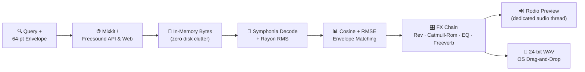

<div align="center">


# SFX de Babel

**Envelope-matched sound effects search, pure-Rust DSP FX Rack, and instant 24-bit WAV drag-and-drop**

[](https://www.rust-lang.org/)
[](https://v2.tauri.app/)
[](https://www.typescriptlang.org/)
[](https://www.sqlite.org/)
[](./LICENSE)

[Features](#-features) · [DSP Pipeline](#-dsp-pipeline) · [Tech Stack](#-tech-stack) · [Build & Run](#-build--run) · [Shortcuts](#-shortcuts)

</div>

---

> [!NOTE]
> **Works out of the box with zero external FFmpeg or API keys.** A pure-Rust audio engine decodes previews straight into RAM, extracts 64-point RMS envelopes, applies real-time studio FX, and exports **24-bit PCM WAV** files directly onto the timeline of Premiere Pro, DaVinci Resolve, CapCut, or FL Studio.

---

## ✨ Features

| Module | What it does | Stack |
| :--- | :--- | :--- |
| 🌊 **Envelope Matching** | Draw a custom volume contour (`64` bins) on canvas and rank sounds live by shape similarity | `HTML5 Canvas` + `Rayon` |
| 🎚️ **Audio FX Rack** | Non-destructive DSP chain: `Slowed`, `Speedup`, `Reverse`, `Freeverb`, `LPF/HPF`, `Drive`, `Fade`, `Limiter` | Pure-Rust `fx.rs` |
| ♾️ **Infinite Scroll** | Seamless cursor pagination with ID deduplication and built-in **RU → EN** SFX query translation | `Mixkit` + `Freesound` |
| 🧲 **Native Drag & Drop** | Drag any card outside the window to render and drop a 24-bit `.wav` straight into your DAW or NLE | `tauri-plugin-drag` + `hound` |
| ⚡ **Instant Preview** | Dedicated playback thread with waveform click-to-seek, SQLite metadata/vector cache, and RAM LRU buffer | `symphonia` + `rodio` + `rusqlite` |
| 🌍 **5 UI Languages** | Instant runtime switching in Settings between **EN**, **RU**, **ES**, **pt-BR**, and **zh-CN** | `SQLite` + `i18n.ts` |

> [!TIP]
> **Double-click** any slider in **FX Rack** to reset it to default. Tweaking any FX parameter updates the active card's 64-point waveform, duration, and scope reference contour automatically after an `80 ms` debounce.

---

## 🔄 DSP Pipeline



<details>
<summary><b>🔬 Under the Hood: DSP Algorithms (<code>src-tauri/src/audio/fx.rs</code>)</b></summary>

1. **Reverse:** Frame-accurate interleaved reversal (`chunks_exact(channels)`) preserving `[L, R]` channel order.
2. **Speed / Pitch (`0.50x – 2.00x`):** 4-point **Catmull-Rom** cubic interpolation per channel, preceded by a Butterworth anti-aliasing low-pass filter when speeding up (`> 1.02x`).
3. **Biquad EQ (`Lowpass` / `Highpass`):** Second-order RBJ Audio EQ Cookbook filters (Direct Form II Transposed with independent per-channel state and denormal flushing).
4. **Drive (Saturator):** Soft waveshaper `(x * gain).tanh() / gain.tanh()` with automatic gain compensation.
5. **Algorithmic Stereo Freeverb:** Automatic mono-to-stereo upmix, `8` parallel damped comb filters + `4` series all-pass filters with a `+23`-sample stereo spread, reverb tail extension, and smooth `-60 dBFS` silence trimming.
6. **Fade & Limiter:** Raised-cosine `Fade In / Fade Out`, `-0.3 dBFS` (`0.96605`) peak normalization, and `[-0.98, 0.98]` soft/hard safety limiter.

</details>

---

## 🎯 Presets

<details>
<summary><b>🎚️ One-Click FX Rack & Envelope Scope Presets</b></summary>

### FX Rack Presets
| Preset | Effect |
| :--- | :--- |
| `Clean (Reset)` | Bypass FX with `-0.3 dBFS` peak normalization |
| `Slowed + Reverb` | `0.80x` pitch-down, `42%` Freeverb (`Room 78%`), LPF `14.0 kHz` |
| `Speedup` | `1.32x` pitch-up, HPF `60 Hz`, subtle `12%` Drive |
| `Reverse Riser` | Reversed buffer with `28%` reverb and `40 / 60 ms` fades |
| `Muffled / Underwater` | Steep `LPF 850 Hz`, `HPF 80 Hz`, deep damped room |
| `Heavy Impact` | `0.90x`, `55%` Drive saturation, punchy midrange, short room |

### Envelope Scope Presets
- `Whoosh` — centered bell-curve swell
- `Impact` — sharp initial transient with exponential decay
- `Sub Drop` — fast attack with sustained low-end tail
- `UI Click` — ultra-short impulse
- `Riser` — rising build-up to a sharp cutoff

</details>

---

## 🌐 Sound Sources & Caching

- **`Auto` Mode (default):** Starts with keyless **Mixkit** results and seamlessly continues into **Freesound Web** pages as you scroll past the initial list or search niche terms.
- **Freesound API v2:** Paste your personal token in **Settings** for direct API search with server-side duration filtering.
- **Persistence:** 64-point RMS envelopes, metadata, and settings (including interface language) are stored in bundled SQLite (`WAL`), while decoded audio stays in a `128`-entry RAM LRU cache for instant FX tweaking.

> [!IMPORTANT]
> When scrolling deeply without an API key, public Freesound Web search may temporarily rate-limit with **HTTP 429**. Existing results stay intact and a **Retry** button appears at the bottom of the list.

---

## 🧱 Project Structure

```text
sfxdebabel/
├── src/                          # Frontend (Vanilla TypeScript, HTML5 Canvas, CSS)
│   ├── index.html                # 3-pane studio layout (Sidebar + Stage + FX Rack)
│   ├── styles.css                # Graphite Dark Glassmorphism (4px grid, hairlines)
│   ├── i18n.ts                   # Localization dictionaries (EN, RU, ES, pt-BR, zh-CN)
│   └── main.ts                   # Canvas Scope, Infinite Scroll, FX Rack, Drag-and-Drop
├── src-tauri/                    # Rust Backend (Tauri v2)
│   ├── tauri.conf.json           # Frameless transparent window (shadow: false)
│   ├── capabilities/default.json # Window, edge-resize, and tauri-plugin-drag permissions
│   └── src/
│       ├── audio/
│       │   ├── decoder.rs        # In-memory Symphonia decoder (MP3, OGG, WAV, FLAC)
│       │   ├── envelope.rs       # Rayon 64-pt RMS extraction & Cosine+RMSE matching
│       │   ├── fx.rs             # Pure-Rust DSP effects chain
│       │   ├── player.rs         # Dedicated Rodio audio thread with seek support
│       │   └── export.rs         # 16-bit & 24-bit WAV export via Hound
│       ├── providers/
│       │   ├── mod.rs            # SfxProvider trait & RU → EN query normalizer
│       │   ├── freesound.rs      # Paginated Freesound API v2 provider
│       │   ├── freesound_web.rs  # Keyless public Freesound Web continuation provider
│       │   └── mixkit.rs         # Paginated Mixkit HTML scraper
│       ├── db.rs                 # Bundled SQLite settings & envelope cache
│       ├── commands.rs           # Tauri IPC commands & RAM LRU cache
│       ├── models.rs             # Shared IPC & settings structs
│       ├── error.rs              # Typed AppError via thiserror
│       └── lib.rs                # App setup & command registration
├── package.json
├── tsconfig.json
└── vite.config.ts
```

---

## 🛠️ Tech Stack

| Layer | Technologies |
| :--- | :--- |
| **Desktop / IPC** | Rust (`2021`), Tauri v2, `tauri-plugin-drag`, `tokio` |
| **Audio & DSP** | `symphonia`, `rodio`, `hound`, `rayon` |
| **Network & HTML** | `reqwest` (`rustls-tls`), `scraper`, `serde`, `serde_json` |
| **Database** | `rusqlite` (`bundled` SQLite + `WAL`) |
| **Frontend** | Vanilla TypeScript, HTML5 Canvas, CSS, Vite |

---

## 🚀 Build & Run

### Prerequisites
- **Rust** (`1.82+`, edition `2021`) + MSVC Build Tools on Windows
- **Node.js** `18+`

### Development Mode

```bash
git clone https://github.com/xantanax1/sfxdebabel.git
cd sfxdebabel
npm install
npm run tauri dev
```

> [!WARNING]
> **Windows PowerShell:** If script execution policy blocks `npm.ps1`, run commands via `.cmd` shims (`npm.cmd install` and `npm.cmd run tauri dev`) or use `cmd.exe`.

### Checks & Release Build

```bash
# TypeScript check & frontend bundle
npm run build

# Rust check & unit tests (DSP, 24-bit WAV roundtrip, scrapers, RU→EN)
cd src-tauri
cargo check
cargo test

# Build release installer / binary
npm run tauri build
```

---

## ⌨️ Shortcuts

| Action | Shortcut / Gesture |
| :--- | :--- |
| Focus search bar | <kbd>Ctrl</kbd> + <kbd>K</kbd> / <kbd>Cmd</kbd> + <kbd>K</kbd> |
| Play / Stop preview | <kbd>Space</kbd> |
| Seek within sound | Click anywhere on a card's mini-waveform |
| Reset FX slider | Double-click any FX Rack slider |
| Export 24-bit WAV to DAW / NLE | Drag any sound card out of the window |

---

## 📄 License

Distributed under the [MIT License](./LICENSE).
