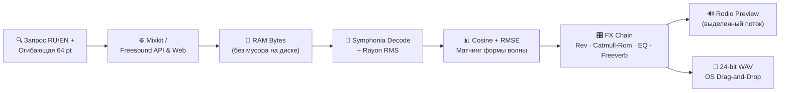

<div align="center">


# SFX de Babel

**Поиск звуковых эффектов по форме волны, Pure-Rust DSP FX Rack и мгновенный Drag-and-Drop 24-bit WAV**

[](https://www.rust-lang.org/)
[](https://v2.tauri.app/)
[](https://www.typescriptlang.org/)
[](https://www.sqlite.org/)
[](./LICENSE)

[Возможности](#-возможности) · [Пайплайн DSP](#-пайплайн-обработки) · [Стек](#-технологический-стек) · [Установка](#-сборка-и-запуск) · [Клавиши](#-горячие-клавиши)

</div>

---

> [!NOTE]
> **Работает сразу «из коробки» без системного FFmpeg и API-ключей.** Встроенный Pure-Rust аудиодвижок декодирует превью прямо в RAM, считает 64-точечные RMS-огибающие, применяет студийные эффекты и экспортирует готовые **24-bit PCM WAV** в Premiere Pro, DaVinci Resolve, CapCut и FL Studio.

---

## ✨ Возможности

| Модуль | Что делает | Технология |
| :--- | :--- | :--- |
| 🌊 **Envelope Matching** | Поиск звуков по нарисованной мышкой кривой громкости (`64` точки) с живым пересчётом процента совпадения | `HTML5 Canvas` + `Rayon` |
| 🎚️ **Audio FX Rack** | Неразрушающая обработка в реальном времени: `Slowed`, `Speedup`, `Reverse`, `Freeverb`, `LPF/HPF`, `Drive`, `Fade`, `Limiter` | Pure-Rust `fx.rs` |
| ♾️ **Бесконечный скролл** | Потоковая дозагрузка новых страниц при прокрутке с дедупликацией и переводом русских запросов **RU → EN** | `Mixkit` + `Freesound` |
| 🧲 **Нативный Drag & Drop** | Захват любой карточки из окна сразу передаёт обработанный `.wav` файл прямо на таймлайн DAW / NLE | `tauri-plugin-drag` + `hound` |
| ⚡ **Мгновенное прослушивание** | Превью и перемотка по вейвформе в выделенном аудиопотоке с авто-кэшированием в RAM и SQLite | `symphonia` + `rodio` + `rusqlite` |

> [!TIP]
> **Двойной клик** по любому слайдеру в **FX Rack** сбрасывает параметр в значение по умолчанию, а при изменении настроек эффектов вейвформа и длительность карточки пересчитываются автоматически через `80 ms`.

---

## 🔄 Пайплайн обработки



<details>
<summary><b>🔬 Подробнее о DSP-алгоритмах под капотом (<code>src-tauri/src/audio/fx.rs</code>)</b></summary>

1. **Reverse:** покадровый разворот буфера (`chunks_exact(channels)`) с сохранением порядка стереоканалов `[L, R]`.
2. **Speed / Pitch (`0.50x – 2.00x`):** 4-точечная кубическая интерполяция **Catmull-Rom** по каждому каналу; при ускорении (`> 1.02x`) предварительно включается антиалиасинговый ФНЧ Баттерворта.
3. **Biquad EQ (`Lowpass` / `Highpass`):** фильтры второго порядка по **Audio EQ Cookbook** (Direct Form II Transposed, независимое состояние на канал, защита от денормалов).
4. **Drive (Saturator):** мягкий вейвшейпер `(x * gain).tanh() / gain.tanh()` с компенсацией громкости.
5. **Algorithmic Stereo Freeverb:** автоматический апмикс моно в стерео, `8` параллельных демпфированных comb-фильтров + `4` последовательных all-pass фильтра со стерео-сдвигом `+23` сэмпла на правый канал, добавлением хвоста реверберации и плавной обрезкой тишины ниже `-60 dBFS`.
6. **Fade & Limiter:** приподнятая косинусоида для `Fade In / Fade Out`, пиковая нормализация к `-0.3 dBFS` (`0.96605`) и мягкий/жёсткий лимитер `[-0.98, 0.98]`.

</details>

---

## 🎯 Пресеты

<details>
<summary><b>🎚️ Пресеты FX Rack (1 клик) и шаблоны огибающей</b></summary>

### Пресеты эффектов (**FX Rack**)
| Пресет | Эффект |
| :--- | :--- |
| `Clean (Reset)` | Чистый сигнал с нормализацией `-0.3 dBFS` |
| `Slowed + Reverb` | `0.80x` pitch-down, `42%` Freeverb (`Room 78%`), LPF `14.0 kHz` |
| `Speedup` | `1.32x` ускорение, HPF `60 Hz`, лёгкий `Drive 12%` |
| `Reverse Riser` | Реверс с реверберацией `28%` и плавными фейдами `40 / 60 ms` |
| `Muffled / Underwater` | Срез верхов `LPF 850 Hz`, `HPF 80 Hz`, глубокий dampened reverb |
| `Heavy Impact` | `0.90x`, насыщенный `Drive 55%`, плотная середина и короткий room |

### Пресеты огибающей (**Envelope Scope**)
- `Whoosh` — колоколообразная волна с пиком в центре
- `Impact` — мгновенный транзиент в начале и экспоненциальный спад
- `Sub Drop` — быстрая атака с длинным низкочастотным хвостом
- `UI Click` — ультракороткий импульс
- `Riser` — нарастание до пика к финалу с резким срезом

</details>

---

## 🌐 Источники звуков и кэширование

- **Режим `Auto` (по умолчанию):** работает без регистрации через **Mixkit**, а при прокрутке за пределы выдачи (или по специфическим запросам) бесшовно догружает результаты из **Freesound Web**.
- **Freesound API v2:** откройте **Настройки** в левом сайдбаре и вставьте токен — откроется прямой поиск по полной базе с серверной фильтрацией длительности.
- **Локальное хранилище:** 64-точечные RMS-векторы и метаданные сохраняются в локальной БД SQLite (`WAL`), а декодированные буферы удерживаются в LRU-кэше в RAM (до `128` треков).

> [!IMPORTANT]
> В режиме без API-ключа при очень быстрой и длинной прокрутке каталога Freesound Web может временно вернуть **HTTP 429**. Приложение не теряет уже найденные треки и отображает кнопку **«Повторить»** внизу списка.

---

## 🧱 Структура проекта

```text
sfxdebabel/
├── src/                          # Frontend (Vanilla TypeScript, HTML5 Canvas, CSS)
│   ├── index.html                # 3-панельный студийный UI (Sidebar + Stage + FX Rack)
│   ├── styles.css                # Graphite Dark Glassmorphism (сетка 4px, hairline-границы)
│   └── main.ts                   # Canvas Scope, Infinite Scroll, FX Rack, Drag-and-Drop
├── src-tauri/                    # Rust Backend (Tauri v2)
│   ├── tauri.conf.json           # Прозрачное безрамочное окно, shadow: false
│   ├── capabilities/default.json # Права окна, edge-resize и tauri-plugin-drag
│   └── src/
│       ├── audio/
│       │   ├── decoder.rs        # Symphonia декодер из памяти (MP3, OGG, WAV, FLAC)
│       │   ├── envelope.rs       # Rayon 64-pt RMS и гибридный матчинг (Cosine + RMSE)
│       │   ├── fx.rs             # Pure-Rust DSP цепочка эффектов
│       │   ├── player.rs         # Выделенный аудиопоток Rodio с перемоткой
│       │   └── export.rs         # Экспорт 16-bit и 24-bit WAV через Hound
│       ├── providers/
│       │   ├── mod.rs            # Трейт SfxProvider и словарь RU → EN
│       │   ├── freesound.rs      # Freesound API v2 с постраничной пагинацией
│       │   ├── freesound_web.rs  # Публичный веб-поиск Freesound (без ключа)
│       │   └── mixkit.rs         # Парсер Mixkit с пагинацией
│       ├── db.rs                 # SQLite кэш и настройки (rusqlite bundled)
│       ├── commands.rs           # Tauri IPC команды и LRU-кэш
│       ├── models.rs             # Типы запросов/ответов
│       ├── error.rs              # Единая обработка ошибок (thiserror)
│       └── lib.rs                # Регистрация плагинов и команд
├── package.json
├── tsconfig.json
└── vite.config.ts
```

---

## 🛠️ Технологический стек

| Слой | Компоненты |
| :--- | :--- |
| **Desktop / IPC** | Rust (`2021`), Tauri v2, `tauri-plugin-drag`, `tokio` |
| **DSP и аудио** | `symphonia`, `rodio`, `hound`, `rayon` |
| **Сеть и скрапинг** | `reqwest` (`rustls-tls`), `scraper`, `serde`, `serde_json` |
| **База данных** | `rusqlite` (`bundled` SQLite + `WAL`) |
| **Frontend** | Vanilla TypeScript, HTML5 Canvas, CSS, Vite |

---

## 🚀 Сборка и запуск

### Предварительные требования
- **Rust** (`1.82+`, edition `2021`) + MSVC Build Tools на Windows
- **Node.js** `18+`

### Запуск в режиме разработки

```bash
git clone https://github.com/xantanax1/sfxdebabel.git
cd sfxdebabel
npm install
npm run tauri dev
```

> [!WARNING]
> **Windows PowerShell:** если политика выполнения скриптов блокирует `npm.ps1`, запускайте команды через `.cmd`-обёртки: `npm.cmd install` и `npm.cmd run tauri dev` (либо работайте из `cmd.exe`).

### Проверка и продакшн-сборка

```bash
# Проверка TypeScript и сборка фронтенда
npm run build

# Проверка и юнит-тесты Rust (DSP, 24-bit WAV, парсеры, RU→EN)
cd src-tauri
cargo check
cargo test

# Сборка установщика Tauri
npm run tauri build
```

---

## ⌨️ Горячие клавиши

| Действие | Управление |
| :--- | :--- |
| Фокус на поиск | <kbd>Ctrl</kbd> + <kbd>K</kbd> / <kbd>Cmd</kbd> + <kbd>K</kbd> |
| Воспроизвести / остановить | <kbd>Space</kbd> |
| Перемотка по звуку | Клик по мини-вейвформе карточки |
| Сброс параметра FX Rack | Двойной клик по слайдеру |
| Экспорт 24-bit WAV в DAW / NLE | Перетаскивание карточки за пределы окна |

---

## 📄 Лицензия

Распространяется под лицензией [MIT](./LICENSE).
