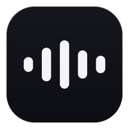
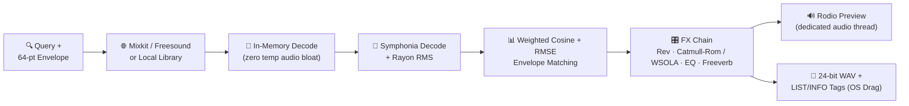

<div align="center">



# SFX de Babel

**Envelope-matched sound effects search, pure-Rust DSP FX Rack, local library indexing, and instant 24-bit WAV drag-and-drop**

[](https://github.com/xantanax1/sfxdebabel/actions/workflows/ci.yml)
[](https://www.rust-lang.org/)
[](https://v2.tauri.app/)
[](https://www.typescriptlang.org/)
[](https://www.sqlite.org/)
[](./LICENSE)

[Features](#-features) · [DSP Pipeline](#-dsp-pipeline) · [Local Library](#-local-library) · [Licenses & Attribution](#-licenses--attribution) · [Responsible Use](#-responsible-use) · [Project Structure](#-project-structure) · [Build & Tests](#-build--run) · [Shortcuts](#-shortcuts)

</div>

---

> [!NOTE]
> **Works out of the box with zero external FFmpeg or API keys.** A pure-Rust audio engine decodes previews straight into RAM, extracts 64-point RMS envelopes, applies real-time studio FX (including pitch-preserving WSOLA time-stretch), embeds license metadata into exported **24-bit PCM WAV** files, and supports dragging sounds directly onto the timeline of Premiere Pro, DaVinci Resolve, CapCut, or FL Studio.

See [`docs/README.md`](./docs/README.md) for the screenshot & GIF capture checklist (currently tracked with explicit `TODO` placeholders).

---

## ✨ Features

| Module | What it does | Stack |
| :--- | :--- | :--- |
| 🌊 **Envelope Matching** | Draw a custom volume contour (`64` bins) on canvas and rank results live with configurable **Cosine vs. RMSE** weighting | `HTML5 Canvas` + `Rayon` |
| 📁 **Local Library** | Recursive folder scan (`mp3/ogg/wav/flac`), incremental `(path, mtime, size)` SQLite indexing, live progress & cancel, full-library search | `tauri-plugin-dialog` + `Rayon` + `SQLite` |
| 🎚️ **Audio FX Rack** | Non-destructive DSP chain: `Pitch + Tempo` or `Tempo Only` (WSOLA), `Reverse`, `Freeverb`, `LPF/HPF`, `Drive`, `Fade`, `Limiter` | Pure-Rust `fx.rs` |
| 🏷️ **Licenses & WAV Tags** | Per-card license badges & inline warnings, `commercial-only without attribution` filter, and RIFF `LIST`/`INFO` WAV tags | `license.rs` + `export.rs` |
| 🛡️ **Provider Reliability** | Per-provider rate gate (`≤ 2 req/s`), `429` exponential backoff + `Retry-After`, and explicit markup-change detection | `providers/http.rs` + HTML fixtures |
| ♾️ **Infinite Scroll** | Seamless cursor pagination with ID deduplication and built-in **RU → EN** SFX query translation | `Mixkit` + `Freesound` |
| 🧲 **Native Drag & Drop** | Drag any card outside the window to render and drop a 24-bit `.wav` straight into your DAW or NLE | `tauri-plugin-drag` + `hound` |
| ⚡ **Instant Preview** | Dedicated playback thread with waveform click-to-seek, SQLite metadata/vector cache, and `128`-entry RAM LRU buffer | `symphonia` + `rodio` + `rusqlite` |
| 🌍 **5 UI Languages** | Instant runtime switching in Settings between **EN**, **RU**, **ES**, **pt-BR**, and **zh-CN** | `SQLite` + `i18n.ts` |

> [!TIP]
> **Double-click** any slider in **FX Rack** (or the envelope **Cosine vs. RMSE** slider in **Settings**) to reset it to its default value. Tweaking any FX parameter updates the active card's 64-point waveform, duration, and scope reference contour automatically after an `80 ms` debounce.

---

## 🔄 DSP Pipeline



<details>
<summary><b>🔬 Under the Hood: DSP Algorithms (<code>src-tauri/src/audio/fx.rs</code> &amp; <code>export.rs</code>)</b></summary>

1. **Reverse:** Frame-accurate interleaved reversal (`chunks_exact(channels)`) preserving `[L, R]` channel order.
2. **Speed (`0.50x – 2.00x`):**
   - **Pitch + Tempo:** 4-point **Catmull-Rom** cubic interpolation per channel, preceded by a Butterworth anti-aliasing low-pass filter when speeding up (`> 1.02x`).
   - **Tempo Only (WSOLA):** Pure-Rust Waveform Similarity Overlap-Add (`~40 ms` periodic Hann window, `50%` overlap, `±9 ms` coarse-to-fine joint multi-channel cross-correlation) that changes duration without shifting pitch and keeps stereo channels phase-locked.
3. **Biquad EQ (`Lowpass` / `Highpass`):** Second-order RBJ Audio EQ Cookbook filters (Direct Form II Transposed with independent per-channel state and denormal flushing).
4. **Drive (Saturator):** Soft waveshaper `(x * gain).tanh() / gain.tanh()` with automatic gain compensation.
5. **Algorithmic Stereo Freeverb:** Automatic mono-to-stereo upmix, `8` parallel damped comb filters + `4` series all-pass filters with a `+23`-sample stereo spread, reverb tail extension, and smooth `-60 dBFS` silence trimming.
6. **Fade & Limiter:** Raised-cosine `Fade In / Fade Out`, `-0.3 dBFS` (`0.96605`) peak normalization, and `[-0.98, 0.98]` soft/hard safety limiter.
7. **WAV Export (`LIST`/`INFO`):** Exports 16-bit or 24-bit PCM WAV via `hound`, then appends word-aligned RIFF `LIST`/`INFO` tags (`INAM`, `IART`, `ICMT`, `ICOP`, `ISRC`) and updates the RIFF chunk size.

</details>

---

## 🎯 Presets

<details>
<summary><b>🎚️ One-Click FX Rack &amp; Envelope Scope Presets</b></summary>

### FX Rack Presets
| Preset | Effect |
| :--- | :--- |
| `Clean (Reset)` | Bypass FX (`Pitch + tempo` mode) with `-0.3 dBFS` peak normalization |
| `Slowed + Reverb` | `0.80x` pitch-down, `42%` Freeverb (`Room 78%`), LPF `14.0 kHz` |
| `Speedup` | `1.32x` pitch-up, HPF `60 Hz`, subtle `12%` Drive |
| `Reverse Riser` | Reversed buffer with `28%` reverb and `40 / 60 ms` fades |
| `Muffled / Underwater` | Steep `LPF 850 Hz`, `HPF 80 Hz`, deep damped room |
| `Heavy Impact` | `0.90x`, `55%` Drive saturation, punchy midrange, short room |

### Envelope Scope Presets
- `Whoosh` — centered bell-curve swell
- `Impact` — sharp initial transient with exponential decay
- `Sub Drop` — fast attack with sustained low-end tail
- `UI Click` — ultra-short impulse
- `Riser` — rising build-up to a sharp cutoff

</details>

---

## 📁 Local Library

Search your own sound collection by drawn volume envelope and filename/folder tokens without uploading anything:

1. Open **Settings** → **Local library** and click **Choose folder…** (native OS folder picker via `tauri-plugin-dialog`).
2. Click **Index folder**. The backend recursively walks `.mp3`, `.ogg`, `.wav`, and `.flac` files (`150 MB` safety cap per file; symlinked directories are skipped to avoid loops), decodes them in parallel via `rayon`, and writes 64-point RMS envelopes into the SQLite `library_files` table.
3. Re-indexing checks `(path, mtime, size)` and only re-analyzes new or changed files while removing deleted entries. You can click **Cancel** mid-run and keep all progress indexed so far.
4. Set **Sound source** to **Local library only (indexed folder)**. Queries search the entire indexed folder (paged in `28`-item cursor batches `lib:N`), automatically relaxing the duration filter with a banner notice if nothing falls inside the exact slider range.
5. **Security boundary:** Local audio reads only allow file paths present in the `library_files` index (`LIBRARY|NOT_INDEXED` otherwise).
6. **Envelope Match Weight (`Settings`):** Adjust the **Cosine (shape) vs. RMSE (level)** slider (`0–100%`, default `65%`). Both backend ranking and live client-side contour re-scoring use this exact weight.

---

## 🏷️ Licenses & Attribution

- **Card Badges & Inline Warnings:** Every result displays a license badge (`Creative Commons 0`, `CC BY`, `CC BY-NC`, `CC Sampling+`, `Mixkit Sound Effects Free License`, `Local file`, or `License unknown`). Sounds that require credit or forbid commercial use show inline `Attribution required` / `No commercial use` indicators directly on the card—no modal dialogs.
- **WAV `LIST`/`INFO` Metadata:** When exporting or dragging an online sound to WAV, the app writes `INAM` (title), `IART` (author), `ICMT` (license name, license URL, source URL), `ICOP` (license name), and `ISRC` (source URL) into the RIFF `LIST`/`INFO` chunk. For local files (`local`), license fields are omitted because the app makes no licensing claim about files on your disk.
- **Commercial-Only Filter (`Only sounds cleared for commercial use without attribution`):**
  - Keeps only sounds positively confirmed to allow commercial use without attribution (`CC0`, `Mixkit Sound Effects Free License`), passing `license:"Creative Commons 0"` to Freesound API v2.
  - **Limitation:** Public keyless **Freesound Web** search pages do not expose per-sound license metadata, so those results are marked `unknown` and **excluded (returning zero results)** while this filter is enabled.
- **No Guessing:** Whenever a source does not provide license data or returns an unrecognized string, it is marked `unknown` with no attribution or commercial-use assumptions.

---

## 🌐 Sound Sources & Caching

- **`Auto` Mode (default):** Uses **Freesound API v2** when an API key is set, falling back to **Mixkit** and **Freesound Web**; without a key, starts with keyless **Mixkit** results and seamlessly continues into **Freesound Web** pages.
- **Freesound API v2:** Paste your personal token in **Settings** for direct API search with server-side duration and CC0 filtering.
- **`Local library` Mode:** Searches only the indexed local folder (`Local` provider indicator in the sidebar footer).
- **Persistence & Migrations:** SQLite (`WAL`) stores settings (`provider_mode`, `freesound_api_key`, `language`, `commercial_only_no_attribution`, `library_dir`, `cosine_weight`), cached online envelopes with backward-compatible license column migrations, and the `library_files` index. Decoded audio stays in a `128`-entry RAM LRU cache for instant FX tweaking.

---

## 🛡️ Responsible Use

- **License Compliance:** Users are solely responsible for verifying and respecting the license terms, attribution rules, and platform Terms of Service for every sound they download, modify, or publish. In-app badges, filters, and embedded WAV `LIST`/`INFO` tags mirror source-reported metadata (or `unknown` when unavailable) and do not constitute legal advice or replace checking the original source page.
- **Polite Network Access:** Keyless HTML providers share per-provider `RateGate` limiters (`≤ 2 requests/sec`, `500 ms` minimum spacing), send an explicit `SFX-de-Babel` desktop `User-Agent`, and handle HTTP `429` with up to `3` attempts using exponential backoff with jitter and `Retry-After` headers. If upstream HTML markup changes, the app surfaces a localized layout-change error instead of failing silently.

---

## 🧱 Project Structure

```text
sfxdebabel/
├── .github/workflows/
│   ├── ci.yml                    # Push/PR checks: npm build, cargo check, cargo test (Win + Ubuntu)
│   └── release.yml               # Tag v* Tauri installer builds & draft GitHub Releases
├── docs/
│   └── README.md                 # Capture guide & TODO placeholders for screenshots/GIFs
├── src/                          # Frontend (Vanilla TypeScript, HTML5 Canvas, CSS)
│   ├── index.html                # 3-pane studio layout (Sidebar + Stage + FX Rack + Settings)
│   ├── styles.css                # Graphite Dark Glassmorphism (4px grid, hairlines, progress bar)
│   ├── i18n.ts                   # Localization dictionaries (EN, RU, ES, pt-BR, zh-CN)
│   └── main.ts                   # Canvas Scope, Infinite Scroll, FX Rack, Local Library UI, Drag-and-Drop
├── src-tauri/                    # Rust Backend (Tauri v2)
│   ├── tauri.conf.json           # Frameless transparent window (shadow: false)
│   ├── capabilities/default.json # Window, edge-resize, drag, and dialog permissions
│   ├── tests/fixtures/           # Saved HTML fixtures for Mixkit & Freesound Web parser tests
│   └── src/
│       ├── audio/
│       │   ├── decoder.rs        # In-memory Symphonia decoder (MP3, OGG, WAV, FLAC)
│       │   ├── envelope.rs       # Rayon 64-pt RMS extraction & weighted Cosine+RMSE matching
│       │   ├── fx.rs             # Pure-Rust DSP chain (Catmull-Rom + WSOLA + EQ + Freeverb)
│       │   ├── player.rs         # Dedicated Rodio audio thread with seek support
│       │   └── export.rs         # 16-bit & 24-bit WAV export via Hound + RIFF LIST/INFO tags
│       ├── providers/
│       │   ├── mod.rs            # SfxProvider trait & RU → EN query normalizer
│       │   ├── http.rs           # RateGate (<=2 req/s), 429 exponential backoff + Retry-After
│       │   ├── freesound.rs      # Paginated Freesound API v2 provider (with CC0 filter)
│       │   ├── freesound_web.rs  # Keyless public Freesound Web parser + layout checks
│       │   └── mixkit.rs         # Paginated Mixkit HTML parser + layout checks
│       ├── license.rs            # LicenseInfo mapping (CC URLs, Mixkit SFX Free, unknown/local)
│       ├── library.rs            # Recursive scanner, parallel incremental indexer & ranking
│       ├── db.rs                 # Bundled SQLite settings, cache migrations & library_files
│       ├── commands.rs           # Tauri IPC commands, library events & RAM LRU cache
│       ├── models.rs             # Shared IPC & settings structs
│       ├── error.rs              # Typed AppError via thiserror (machine-readable UI markers)
│       └── lib.rs                # App setup, plugins (drag, dialog) & command registration
├── package.json
├── tsconfig.json
└── vite.config.ts
```

---

## 🛠️ Tech Stack

| Layer | Technologies |
| :--- | :--- |
| **Desktop / IPC** | Rust (`2021`), Tauri v2, `tauri-plugin-drag`, `tauri-plugin-dialog`, `tokio` |
| **Audio & DSP** | `symphonia`, `rodio`, `hound`, `rayon`, pure-Rust WSOLA & Freeverb |
| **Network & HTML** | `reqwest` (`rustls-tls`), `scraper`, `serde`, `serde_json` |
| **Database** | `rusqlite` (`bundled` SQLite + `WAL`) |
| **Frontend** | Vanilla TypeScript, HTML5 Canvas, CSS, Vite |

---

## ⚙️ Settings Reference

| Setting | Storage Key | Description |
| :--- | :--- | :--- |
| **Interface language** | `language` | `en`, `ru`, `es`, `pt-BR`, or `zh-CN` |
| **Sound source** | `provider_mode` | `auto`, `freesound`, `mixkit`, or `library` |
| **Freesound API Key** | `freesound_api_key` | Optional personal Freesound v2 token stored locally in SQLite |
| **Local library** | `library_dir` | Folder selected via native picker and indexed into `library_files` |
| **Envelope match weight** | `cosine_weight` | Cosine (shape) vs. RMSE (level) blend (`0–100%`, default `65%`) |
| **Commercial without attribution** | `commercial_only_no_attribution` | Shows only positively commercial-safe sounds without credit (`unknown` hidden) |

---

## 🚀 Build & Run

### Prerequisites
- **Rust** (`1.82+`, edition `2021`) + MSVC Build Tools on Windows (or `libwebkit2gtk-4.1-dev`, `libayatana-appindicator3-dev`, `librsvg2-dev`, `libasound2-dev`, `libgtk-3-dev`, `patchelf` on Ubuntu)
- **Node.js** `20+` (`18+` supported)

### Development Mode

```bash
git clone https://github.com/xantanax1/sfxdebabel.git
cd sfxdebabel
npm install
npm run tauri dev
```

> [!WARNING]
> **Windows PowerShell:** If script execution policy blocks `npm.ps1`, run commands via `.cmd` shims (`npm.cmd install`, `npm.cmd run build`, and `npm.cmd run tauri dev`) or use `cmd.exe`.

### Checks & Release Build

```bash
# TypeScript check & frontend bundle
npm run build

# Rust check & unit tests (44 tests)
cd src-tauri
cargo check
cargo test

# Build release installer / binary
npm run tauri build
```

### Automated Test Suite (`44` Rust unit tests)
- **Envelope & Ranking (`audio::envelope`):** 64-point RMS normalization, impulse vs. riser discrimination, ±2-bin shift tolerance, configurable cosine/RMSE weighting, empty input safety.
- **DSP FX (`audio::fx`):** Stereo reverse ordering, Catmull-Rom pitch+tempo lengths, WSOLA tempo-only lengths (`0.5x–2.0x`) without clipping, WSOLA stereo phase-lock sync, WSOLA pitch preservation (`440 Hz` sine check), biquad LPF attenuation, Freeverb tail upmix, drive/limiter ceiling, and speed-mode filename suffix/clean-state distinction.
- **WAV Export (`audio::export`):** 16-bit & 24-bit Symphonia roundtrips, RIFF `LIST`/`INFO` (`INAM`, `IART`, `ICMT`, `ICOP`, `ISRC`) roundtrip with odd byte padding, empty-meta skip.
- **Licensing & DB (`license`, `db`):** Freesound CC URL mapping, conservative `unknown` fallback, legacy row remapping, and non-destructive SQLite schema migration.
- **Local Library (`library`):** Recursive scan + extension filtering, envelope ranking accuracy (`whoosh`/`impact`/`riser`), incremental `(mtime, size)` re-indexing & deleted file pruning, cancellation flag, progress callbacks, path prefix boundary safety, and duration range relaxation.
- **Providers & HTTP (`providers`, `providers::http`, `providers::mixkit`, `providers::freesound_web`):** RU→EN query translation, `RateGate` spacing, `Retry-After` parsing, exponential backoff jitter bounds, real + no-results HTML fixture parsing, and `ProviderLayoutChanged` error triggers.

---

## ⌨️ Shortcuts

| Action | Shortcut / Gesture |
| :--- | :--- |
| Focus search bar | <kbd>Ctrl</kbd> + <kbd>K</kbd> / <kbd>Cmd</kbd> + <kbd>K</kbd> |
| Play / Stop preview | <kbd>Space</kbd> |
| Seek within sound | Click anywhere on a card's mini-waveform |
| Reset slider (FX / Cosine weight) | Double-click slider |
| Export 24-bit WAV to DAW / NLE | Drag any sound card out of the window |

---

## 📄 License

Distributed under the [MIT License](./LICENSE).
